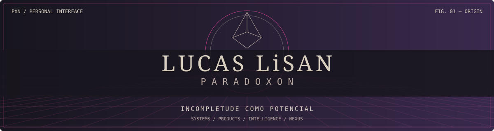
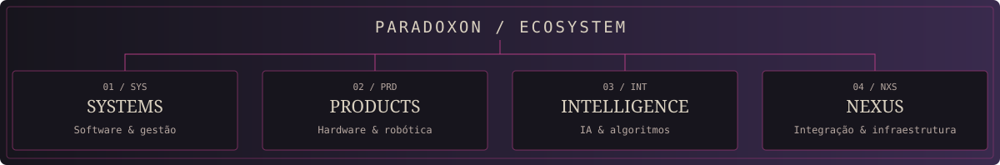

  

  
  

  **DESENVOLVIMENTO · AUTOMAÇÃO · PESQUISA · CRIAÇÃO**

  *Questionar o estabelecido. Construir o inexistente. Aprimorar o que já existe.*

---

## Ⅰ — ORIGIN / Sobre mim

Sou Lucas LiSan, estudante de Desenvolvimento de Software Multiplataforma e desenvolvedor de sistemas. Minha trajetória começou com uma inquietação prática: por que repetir manualmente tarefas no Excel se era possível automatizá-las?

A pergunta evoluiu para outras. Por que limitar a automação a uma planilha? Por que aceitar processos fragmentados? Por que reproduzir digitalmente a burocracia, em vez de repensá-la?

Hoje desenvolvo sistemas de gestão, aplicações web, automações administrativas e projetos que exploram a integração entre software, inteligência artificial e hardware. Minha atuação na administração escolar é também um espaço de observação de problemas reais e desenvolvimento de soluções.

A **PARADOXON** nasce dessa maneira de pensar: um empreendimento tecnológico em construção, orientado à pesquisa, ao desenvolvimento e à criação de produtos e sistemas próprios.

## Ⅱ — PHILOSOPHY / Incompletude como potencial

  

Não considero uma solução definitiva simplesmente porque funciona. O funcionamento é um ponto de partida para investigar limites, compreender consequências e descobrir novas possibilidades.

A incompletude não significa aceitar a precariedade. Significa reconhecer que sempre existe espaço para conhecimento, revisão e evolução, sem abrir mão da qualidade, da responsabilidade e da utilidade do que se entrega hoje.

- **Questionar:** compreender a origem de um problema antes de reproduzir suas soluções.
- **Construir:** transformar ideias em sistemas, produtos e experiências concretas.
- **Aprimorar:** observar, testar, documentar e evoluir continuamente.
- **Simplificar:** assumir a complexidade técnica para reduzir a complexidade enfrentada por quem utiliza a tecnologia.
- **Preservar a autonomia:** valorizar transparência, interoperabilidade, privacidade e liberdade tecnológica.

> A complexidade por trás. A simplicidade à frente.

## Ⅲ — ECOSYSTEM / Projetos, experimentos e frentes de atuação

A PARADOXON é um ecossistema tecnológico em construção, nascido de experiências acumuladas entre projetos pessoais, acadêmicos, profissionais e colaborativos. **Os projetos apresentados nesta página não são necessariamente produtos ou trabalhos comerciais da PARADOXON.** Eles documentam minha trajetória e dialogam com os setores que pretendo desenvolver. *Intelligence* e *Nexus* permanecem como frentes propostas de expansão.

> **ARCHIVE / PROCESSO CONTÍNUO** — Não escondo as primeiras tentativas: cada protótipo, projeto interrompido, colaboração e mudança de direção faz parte do aprendizado. Um projeto não precisa ter chegado ao mercado para ter produzido conhecimento.

### `01 / SYS` — PARADOXON Systems

*Software, sistemas de informação, gestão e transformação digital.*

#### Desenvolvimento atual

**Secretaria Escolar Digital** · *desenvolvimento próprio e aplicação de conhecimentos em processos reais*

Construção progressiva de aplicações de gestão escolar, automatização de rotinas administrativas, integração de dados e documentos, controle de informações funcionais e redução da dependência de processos manuais. O trabalho resulta de sucessivas tentativas de compreender, testar e superar limitações encontradas no cotidiano escolar.

#### Arquivo de desenvolvimento / sistemas escolares

| Projeto | Período / natureza | Experiência e aprendizado |
|:---|:---|:---|
| [secOnline](https://github.com/LucasLiSan/secOnline) | 2023 · primeira tentativa | Primeiros experimentos de um sistema de secretaria escolar; exploração de aplicações web e organização digital de rotinas. |
| [secOnlineProfs](https://github.com/LucasLiSan/secOnlineProfs) | 2023 · protótipo | Folha-espelho de acompanhamento da vida funcional de professores, com experimentação de JSON como armazenamento. |
| [LanaSystem](https://github.com/LucasLiSan/LanaSystem) | 2024 · protótipo | Nova tentativa de criar ferramentas de apoio à administração escolar. |
| [pingoDigital](https://github.com/LucasLiSan/pingoDigital) | 2024 em diante · protótipo | Experimentação com uma plataforma de gestão escolar. [Ver demonstração](https://pingodegente.onrender.com/home). |
| [pingodegente](https://github.com/LucasLiSan/pingodegente) | 2024 · experimento | Página de informações e transparência escolar; uso de arquivos JSON como fonte de dados. [Ver página](https://lucaslisan.github.io/pingodegente/). |

#### Interfaces, serviços e experiências colaborativas

**Learny / Kastle-PI** · *2º semestre de 2024 · participação em equipe, principalmente pesquisa e escrita acadêmica*

Aplicativo de aprendizagem de inglês para crianças com transtorno do espectro autista (TEA), com componentes mobile, API e painel web. Minha contribuição concentrou-se principalmente na **pesquisa e na elaboração do artigo**, não na autoria integral das aplicações. O ecossistema possui repositórios para [mobile](https://github.com/Kastle-PI/learny-mobile), [API](https://github.com/Kastle-PI/learny-mobile-api), [dashboard](https://github.com/Kastle-PI/dashboard-learny) e [site da equipe](https://github.com/Kastle-PI/site-kastle). [Organização Kastle-PI](https://github.com/Kastle-PI).

**Charlie Mic / Equipe Aries** · *2º semestre de 2024 · conceito e exercício acadêmico*

Exploração de uma plataforma para conectar artistas e clientes por região — uma espécie de marketplace de serviços criativos. O trabalho reuniu concepção de produto, prototipagem de interfaces e documentação de uma proposta de negócio. [Repositório do projeto](https://github.com/LucasLiSan/PI-2024s2) · [Protótipo Figma](https://www.figma.com/proto/RXSc8hhcX1ZrxVMlKxbFqO/NewProject?node-id=24-2&t=oEG1BUn5MtwhOEZ2-1&scaling=scale-down&content-scaling=fixed&page-id=0%3A1&starting-point-node-id=3%3A56) · [Landing page experimental](https://github.com/LucasLiSan/ariesLandingPage).

**Turismo acessível e conexão com guias locais** · *1º semestre de 2024 · ideia de projeto*

Conceito de aplicativo para aproximar turistas de guias disponíveis em tempo real, com interesse especial em informações de acessibilidade para pessoas que utilizam cadeira de rodas. [Repositório de ideias e desenvolvimento](https://github.com/LucasLiSan/PI-2024s1).

**Horizonte de desenvolvimento:** consolidar sistemas modulares, aplicações públicas e educacionais, serviços digitais acessíveis, rastreabilidade de processos, APIs e integração de plataformas com maior autonomia.

---

### `02 / PRD` — PARADOXON Products

*Robótica, dispositivos, produtos físicos e experiências interativas.*

**MOBO — Colheita automatizada de lichias** · *participação iniciada no 1º semestre de 2025 · projeto colaborativo*

Protótipo de robótica com plataforma móvel, mecanismos de movimentação, servos, captura de imagens e análise da maturação de lichias. Minha contribuição concentra-se sobretudo em **IoT, firmware e integração entre ESP32/ESP32-CAM, aplicativo mobile e inteligência artificial**. A separação de componentes em firmware, aplicação, API e IA permite explorar a arquitetura de um sistema ciberfísico.

[Organização CW-Mobo](https://github.com/CW-Mobo) · [Firmware](https://github.com/CW-Mobo/firmware) · [Mobile](https://github.com/CW-Mobo/mobile) · [IA](https://github.com/CW-Mobo/ai) · [API](https://github.com/CW-Mobo/api) · [Web](https://github.com/CW-Mobo/web) · [Landing page](https://github.com/CW-Mobo/landing-page) · [Site](https://cw-mobo.github.io/landing-page/) · [Apresentação](https://mobocw.vercel.app/)

**Sistema eleitoral escolar** · *projeto próprio em evolução*

Urnas didáticas, identificação de eleitores, comprovantes, zerésima, boletim de urna, apuração e mecanismos de verificação e registro de ocorrências. O projeto compara arquiteturas de baixo custo, com reaproveitamento de equipamentos, e versões mais robustas com hardware dedicado.

**Horizonte de desenvolvimento:** dispositivos IoT modulares, robótica acessível, sistemas embarcados reparáveis e soluções físicas integradas a aplicações web/mobile.

---

### `03 / INT` — PARADOXON Intelligence

*Inteligência aplicada, dados, algoritmos, otimização e investigação.*

**AiVol — Coleta inteligente de volumosos** · *2025 · desenvolvimento próprio; retomada planejada*

Sistema experimental para otimização de rotas de coleta de resíduos volumosos, com grafos e algoritmo de Dijkstra, considerando agendamentos, volume disponível, capacidade de caminhões, distâncias e deslocamento até pontos de descarte. O projeto explora lógica de coleta parcial, gestão de viagens e persistência de dados. [Repositório](https://github.com/LucasLiSan/AiVol).

**AquaSense / Technote** · *2º semestre de 2023 · colaboração em equipe*

Sistema desktop em Java concebido para acompanhar condições de sistemas de aquaponia, combinando cultivo de peixes e plantas. O projeto descreve leitura de indicadores como pH, temperatura e oxigênio dissolvido, cadastro de tanques e visualização de alertas e recomendações. No README da equipe, minha participação é creditada como **testador e revisor**. [Projeto Java](https://github.com/techn-note/AquaSense-Java) · [Landing page Technote](https://techn-note.github.io/Technote-Web/) · [Código do site](https://github.com/techn-note/Technote-Web) · [Equipe](https://github.com/techn-note).

**MindBridge** · *2023 · experiência acadêmica inicial*

Proposta de análise de expressões faciais por inteligência artificial aplicada a experiências no mercado de perfumaria. Participei da equipe acadêmica; o material aqui vinculado é a primeira experiência de **landing page** para apresentação do conceito. [Landing page / repositório](https://github.com/LucasLiSan/MindBridgeLandingPage).

**EduPredict** · *2026 · aprendizado de máquina*

Experimentação acadêmica com redes neurais MLP para classificação de desempenho educacional, envolvendo preparação de dados, treinamento, avaliação de métricas e disponibilização de predições em API. [Repositório](https://github.com/LucasLiSan/at2AM).

**Visão computacional aplicada ao MOBO** · *desenvolvimento colaborativo*

Processamento de imagens de lichias, treinamento de modelos Keras/TensorFlow e integração de classificação com serviços REST e componentes embarcados. [Código da IA](https://github.com/CW-Mobo/ai).

**Horizonte de desenvolvimento:** modelos de apoio à decisão, otimização operacional, aprendizado de máquina aplicado a problemas concretos e IA integrada a sistemas com supervisão humana.

---

### `04 / NXS` — PARADOXON Nexus

*Integração, conectividade e autonomia tecnológica.*

**Experiências transversais**

- **MOBO:** comunicação entre ESP32, ESP32-CAM, controle de motores/servos, aplicações mobile e serviços de IA; configuração de rede e integração de firmware.
- **AquaSense:** estudo de uma arquitetura envolvendo sensores, aplicação desktop e dados para monitoramento de aquaponia.
- **Secretaria Escolar Digital:** conexão de aplicações, planilhas, documentos, APIs e fluxos de trabalho.
- **AiVol:** integração de modelos de dados, rotas, serviços backend e persistência para a lógica de coleta otimizada.

**Horizonte de desenvolvimento:** interoperabilidade entre dispositivos e software, ambientes locais e em nuvem, infraestrutura modular, sistemas observáveis e redução de dependências desnecessárias.

---

### `ARCHIVE / TIMELINE` — Percurso de criação

| Período | Marcos, tentativas e colaborações |
|:---|:---|
| **2023** | Primeiras aplicações de secretaria escolar; folha-espelho funcional; equipe MindBridge; AquaSense / Technote. |
| **2024** | LanaSystem, pingoDigital e página de transparência; plataforma de guias turísticos acessíveis; marketplace de artistas / Aries; colaboração em pesquisa e artigo do Learny. |
| **2025** | Desenvolvimento e estudo do AiVol; início da participação no MOBO com foco em IoT e integrações. |
| **2026** | Ampliação da Secretaria Escolar Digital; aprofundamento das integrações do MOBO; experimentação com modelos MLP e aplicações de IA. |
| **Adiante** | Retomada do AiVol, consolidação de sistemas próprios e evolução das frentes da PARADOXON. |

*Os períodos indicam início ou contexto da participação; não significam que todos os repositórios foram criados ou concluídos naquela mesma data. A organização por setores é temática: um mesmo projeto pode reunir competências de mais de uma frente.*

## Ⅳ — TOOLCHAIN / Tecnologias

As ferramentas são meios, não limites. Escolho tecnologias de acordo com os problemas, os recursos disponíveis e as necessidades de cada projeto.

**SOFTWARE & INTERFACES**

**DATA & INTELLIGENCE**

**AUTOMATION & HARDWARE**

**ENVIRONMENT & VERSION CONTROL**

## Ⅴ — TELEMETRY / GitHub

  
  

## Ⅵ — CONNECTION / Contato

---

  

