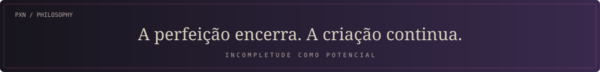

  

  
  

  **DESENVOLVIMENTO · AUTOMAÇÃO · PESQUISA · CRIAÇÃO**

  *Questionar o estabelecido. Construir o inexistente. Aprimorar o que já existe.*

---

## Ⅰ — ORIGIN / Sobre mim

Sou Lucas LiSan, estudante de Desenvolvimento de Software Multiplataforma e desenvolvedor de sistemas. Minha trajetória começou com uma inquietação prática: por que repetir manualmente tarefas no Excel se era possível automatizá-las?

A pergunta evoluiu para outras. Por que limitar a automação a uma planilha? Por que aceitar processos fragmentados? Por que reproduzir digitalmente a burocracia, em vez de repensá-la?

Hoje desenvolvo sistemas de gestão, aplicações web, automações administrativas e projetos que exploram a integração entre software, inteligência artificial e hardware. Minha atuação na administração escolar é também um espaço de observação de problemas reais e desenvolvimento de soluções.

A **PARADOXON** nasce dessa maneira de pensar: um empreendimento tecnológico em construção, orientado à pesquisa, ao desenvolvimento e à criação de produtos e sistemas próprios.

## Ⅱ — PHILOSOPHY / Incompletude como potencial

  

Não considero uma solução definitiva simplesmente porque funciona. O funcionamento é um ponto de partida para investigar limites, compreender consequências e descobrir novas possibilidades.

A incompletude não significa aceitar a precariedade. Significa reconhecer que sempre existe espaço para conhecimento, revisão e evolução, sem abrir mão da qualidade, da responsabilidade e da utilidade do que se entrega hoje.

- **Questionar:** compreender a origem de um problema antes de reproduzir suas soluções.
- **Construir:** transformar ideias em sistemas, produtos e experiências concretas.
- **Aprimorar:** observar, testar, documentar e evoluir continuamente.
- **Simplificar:** assumir a complexidade técnica para reduzir a complexidade enfrentada por quem utiliza a tecnologia.
- **Preservar a autonomia:** valorizar transparência, interoperabilidade, privacidade e liberdade tecnológica.

> A complexidade por trás. A simplicidade à frente.

## Ⅲ — ECOSYSTEM / Frentes de atuação

Os projetos abaixo incluem iniciativas acadêmicas, profissionais e independentes. A organização por setores representa suas afinidades com a visão da PARADOXON, não um catálogo de produtos comerciais já lançados. Intelligence e Nexus são frentes propostas para expansão.

### `01 / SYS` — PARADOXON Systems

*Software, gestão e transformação digital.*

**Desenvolvimento atual e experiências**

- **Secretaria Escolar Digital:** integração de informações e processos administrativos escolares, gestão de servidores, alunos, frequência, faltas, cargas suplementares, calendários e documentos.
- **Automação administrativa:** integração de planilhas, formulários, documentos e serviços do Google Workspace; validação de regras e redução de retrabalho.
- **Aplicações web e APIs:** desenvolvimento de interfaces, serviços REST, persistência de dados e testes de software.

**Horizonte de desenvolvimento**

- Plataforma modular de gestão escolar e pública, com perfis, permissões, auditoria e rastreabilidade.
- Serviços digitais para alunos, responsáveis, profissionais e comunidade.
- Aplicações web, mobile e desktop integradas a uma infraestrutura própria, com migração gradual para arquiteturas mais independentes.

### `02 / PRD` — PARADOXON Products

*Da lógica ao mundo físico.*

**Desenvolvimento atual e experiências**

- **MOBO:** protótipo acadêmico de robótica para colheita de lichias, integrando plataforma móvel, braço articulado, ESP32, ESP32-CAM, controle mobile e visão computacional.
- **Sistema eleitoral escolar:** projeto educativo de urnas, identificação de eleitores, votação, boletins e apuração digital.
- **Prototipagem eletrônica:** integração de microcontroladores, sensores, motores, servos e circuitos de controle.

**Horizonte de desenvolvimento**

- Dispositivos embarcados e soluções IoT acessíveis, modulares e reparáveis.
- Evolução do sistema eleitoral educativo, de equipamentos reaproveitados a terminais dedicados com Raspberry Pi, impressão térmica e registro de ocorrências.
- Produtos físicos e digitais concebidos em conjunto, com atenção ao custo e à viabilidade.

### `03 / INT` — PARADOXON Intelligence

*Dados, algoritmos e inteligência aplicada — frente proposta.*

**Desenvolvimento atual e experiências**

- **AiVol:** projeto acadêmico de otimização da coleta de volumosos utilizando grafos, algoritmo de Dijkstra, distâncias, capacidade de veículos e planejamento de viagens.
- **EduPredict:** experimentação acadêmica com redes neurais MLP e classificação preditiva no contexto educacional, por meio de uma API.
- **Visão computacional no MOBO:** treinamento de modelos para classificação da maturação de lichias.

**Horizonte de desenvolvimento**

- Modelos de apoio à decisão, otimização de recursos e análise de dados.
- Inteligência artificial integrada aos sistemas e produtos, com avaliação de resultados e supervisão humana.
- Pesquisa aplicada em algoritmos, aprendizado de máquina e automação inteligente.

### `04 / NXS` — PARADOXON Nexus

*Conectividade, integração e autonomia tecnológica — frente proposta.*

**Desenvolvimento atual e experiências**

- Integração entre aplicações web, APIs, bancos de dados, serviços de produtividade e dispositivos IoT.
- Comunicação entre microcontroladores, aplicações mobile e serviços de visão computacional.
- Experimentação com redes locais, Wi-Fi, MQTT, controle remoto e integração de hardware e software.

**Horizonte de desenvolvimento**

- Infraestrutura modular, serviços interoperáveis e ambientes de implantação independentes.
- Integração de dispositivos, aplicações e dados com segurança, observabilidade e controle de acesso.
- Adoção progressiva de tecnologias abertas e redução de dependências desnecessárias de plataformas proprietárias.

## Ⅳ — TOOLCHAIN / Tecnologias

As ferramentas são meios, não limites. Escolho tecnologias de acordo com os problemas, os recursos disponíveis e as necessidades de cada projeto.

**SOFTWARE & INTERFACES**

**DATA & INTELLIGENCE**

**AUTOMATION & HARDWARE**

**ENVIRONMENT & VERSION CONTROL**

## Ⅴ — TELEMETRY / GitHub

  
  

## Ⅵ — CONNECTION / Contato

---

  

